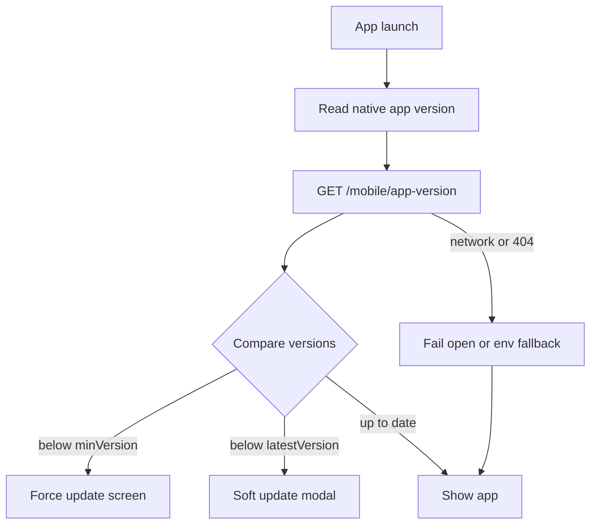

# App version control

ThinkTank Mobile can force or prompt users to update based on a remote version policy. This lets you block outdated builds without shipping a new binary just to change the gate.

## How it works

On launch, `VersionGate` (in `src/components/app/VersionGate.tsx`):

1. Reads the **installed app version** from the native binary (`expo.version` in `app.config.js`).
2. Fetches policy from **`GET {EXPO_PUBLIC_API_URL}/mobile/app-version`**.
3. Compares versions and decides:

| Condition | Behavior |
| --- | --- |
| App version `< minVersion` | **Force update** — full-screen block until they update |
| `minVersion ≤` app `< latestVersion` | **Soft update** — modal with Update / Later |
| App `≥ latestVersion` | Continue normally |
| Endpoint unreachable | **Fail open** — app continues (optional env fallback still applies) |



## Bumping the client version

Every store / TestFlight / Play release must bump the version in config:

| Field | File | Purpose |
| --- | --- | --- |
| `expo.version` | [`app.config.js`](../app.config.js) | User-facing semver (`1.0.0`) — **this is what the gate compares** |
| `ios.buildNumber` | [`app.config.js`](../app.config.js) | iOS build counter (must increase each upload) |
| `android.versionCode` | [`app.config.js`](../app.config.js) | Android integer (must increase each upload) |
| `package.json` `version` | [`package.json`](../package.json) | Keep in sync for humans / CI |

Example for a patch release:

```js
// app.config.js
version: '1.0.1',
ios: { buildNumber: '2', ... },
android: { versionCode: 2, ... },
```

Rebuild the native app after changing these (JS-only reload does not change the native version string).

## Backend API

### Endpoint

```http
GET /mobile/app-version
```

- Base URL: same as `EXPO_PUBLIC_API_URL` (e.g. `https://service.algoarena.co.in`)
- Should be **public** (no auth required)
- Client also accepts a wrapped envelope: `{ "success": true, "data": { ... } }`

### Response body

```json
{
  "minVersion": "1.0.0",
  "latestVersion": "1.2.0",
  "title": "Update required",
  "message": "This release fixes login and meal logging. Please update.",
  "storeUrlIos": "https://apps.apple.com/app/idXXXXXXXX",
  "storeUrlAndroid": "https://play.google.com/store/apps/details?id=com.thinktank.mobile"
}
```

| Field | Required | Notes |
| --- | --- | --- |
| `minVersion` | Yes* | Below this → hard block |
| `latestVersion` | Yes* | Below this (but ≥ min) → soft prompt |
| `title` | No | Override UI title |
| `message` | No | Override UI body |
| `storeUrlIos` | No | Opened on iOS “Update” |
| `storeUrlAndroid` | No | Opened on Android “Update” |

\*At least one of `minVersion` / `latestVersion` must be present. Snake_case aliases (`min_version`, `latest_version`, `iosStoreUrl`, …) are accepted by the client.

### Example policies

**Soft nudge only** (current store build is `1.0.0`):

```json
{
  "minVersion": "1.0.0",
  "latestVersion": "1.1.0",
  "message": "A newer version is available with dashboard improvements."
}
```

Users on `1.0.0` see a dismissible prompt. Users on `1.1.0+` see nothing.

**Force everyone below 1.2.0**:

```json
{
  "minVersion": "1.2.0",
  "latestVersion": "1.2.0",
  "title": "Update required",
  "message": "This version is no longer supported."
}
```

Anyone on `< 1.2.0` cannot use the app until they update.

## Local / env fallback

If the API is not ready yet, you can still test the gate with env vars (see [`.env.example`](../.env.example)):

```env
EXPO_PUBLIC_MIN_APP_VERSION=2.0.0
EXPO_PUBLIC_LATEST_APP_VERSION=2.0.0
EXPO_PUBLIC_IOS_STORE_URL=https://apps.apple.com/app/idXXXXXXXX
EXPO_PUBLIC_ANDROID_STORE_URL=https://play.google.com/store/apps/details?id=com.thinktank.mobile
```

With app version `1.0.0`, that forces the update screen locally after a Metro restart.

Priority: **remote API wins** when it returns a valid config; env is only a fallback.

## Code map

| Piece | Path |
| --- | --- |
| Gate UI | [`src/components/app/VersionGate.tsx`](../src/components/app/VersionGate.tsx) |
| Check + store open | [`src/services/appVersion.ts`](../src/services/appVersion.ts) |
| API fetch + normalize | [`src/api/appVersionApi.ts`](../src/api/appVersionApi.ts) |
| Semver compare | [`src/lib/version/semver.ts`](../src/lib/version/semver.ts) |
| Wired at boot | [`src/app/providers.tsx`](../src/app/providers.tsx) |

## Checklist for a release

1. Bump `version` / `buildNumber` / `versionCode` in `app.config.js`.
2. Ship the binary to TestFlight / Play (or internal build).
3. When you want users on older builds to move:
   - Soft: set `latestVersion` above their version, keep `minVersion` ≤ what you still support.
   - Force: raise `minVersion` to the lowest build you allow.
4. Confirm store URLs in the API (or env) so “Update” opens the right listing.
5. Verify on an old build: force screen blocks; on a mid build: soft modal; on latest: no prompt.

## Notes

- Changing only the API does **not** change the version string inside an already-installed app — it only changes whether that install is allowed.
- Dev clients report the native `expo.version` from the last prebuild/build, not Metro hot reload.
- Version compare is numeric on dotted segments (`1.10.0` > `1.9.0`).
